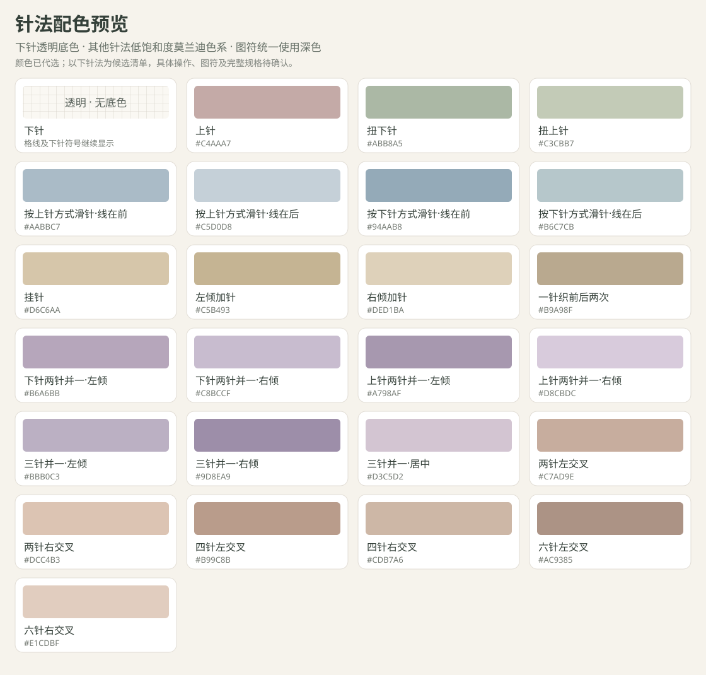

# 针法与花样绘图

> 编写日期：2026-10-26
>
> 文档状态：**用户于 2026-10-26 明确指示“现在改代码吧”，本轮已实现并进入验收**。按已审阅的绘图方向与明确选择实施；下面仍列出的未决规则不因此自动确认。
>
> 规则归属：手动针法填写、花样内容、针格到轮廓的反向设计及其编辑联动以本文为主要说明。现有轮廓、密度、针格和逐行表规则继续由对应功能文档负责。

## 一、功能目的

### 本轮实施依据与编辑约定

本轮增加绘图入口、针法库、花样小样与可移动副本、自定义针法、填充边缘生成轮廓、绘图针数核对、PNG／PDF 中文图例，并实施三个模式更名。保留原模式的独立轮廓与计算。

绘图源数据使用画布整针整行坐标，不随密度或轮廓修改拉伸、镜像或裁剪；改变密度后尺寸随当前密度换算，轮廓须主动重新生成。轮廓外内容仍可编辑并明确提示，最终输出须先协调。多个分离的填充区域生成多个独立路径；候选为准确的针格台阶边缘，不做平滑或 0.5 厘米吸附。只替换本功能此前生成的路径，保留手绘路径。

内部补下针区分系统与手绘来源，每次重新预览／生成时从手绘与花样内容重新计算围合区域；开口后旧自动补针不再锁住边缘。生成时确认补针与路径，作为一次撤销操作。

花样小样中的空白为透明，不覆盖目标。副本作为独立覆盖层保存，移动或删除后露出下层内容；修改副本只影响该副本，不联动原小样或其他副本。跨针操作为一个完整对象，占格、消耗针数和生成针数分开保存；覆盖／擦除触及跨针对象时处理完整对象，不留下半个动作。所有放置／移动先预览，确认才写入；手绘连续涂画在抬笔时统一提交，取消或第二指加入不保存。

自定义针法使用黑色手绘线条，客户定义名称、颜色、占格、输入针数、输出针数及步骤；修改已有定义通过另存新版本保留旧引用，不冒改旧图解。内置教程按明确动作和线位编写，自定义缺图时只显示客户文字，不编造动作图。组合小样显示明确循环，预览后确认生成并能编辑。

针数核对按每片实际针位及完整操作统计：消耗针数、产出针数、内部增减、相邻行衔接和边缘变化分别展示。图形占格不作为消耗／产出针数的替代；与旧几何加减针重复或无法在边缘解释的变化标出冲突并保留设计。现有几何计算快照继续只代表轮廓结果，花样的完整定义和使用保存在源文档，不冒称旧快照包含花样计算。

用户于 2026-10-26 改选常见手织读法：**图符按织物正面外观显示，图例说明正面与反面操作**，替代此前默认实际操作的选择。新方案默认正面外观；平针各行显示下针符号，正面行织下针、反面行织上针。预置花样按正面外观生成，逐行说明仍列实际动作。下针透明、黑色图符、针数与轮廓规则保持。

本次影响：默认读法、空白旧方案恢复、预置组合、逐行针法说明、PNG／PDF 图例和保存。已有针法／小样／副本的旧方案保留其已保存读法，不静默翻转或重新解释旧图解；没有任何设计内容的旧方案采用新默认。现有读法切换入口仍可使用。反面针法说明对上下针及扭上下针明确互换，尚未定义反面动作的复杂针法继续提示和暂停输出，不猜测动作。当前正面外观模式内部补下针代表平针，之前操作读法下平针／搓板补针的待选问题不再阻碍本模式。

验收：新／空白旧方案默认正面外观；有内容旧方案读法不变；预置麻花平针区各行显示下针，反面逐行说明为上针；图例明确“正面织下针／反面织上针”及上针的相反读法，长图例换行与分页不截断；针格、占针、颜色、轮廓、复制、保存和撤销行为不因默认选择改变。鼠标、iPad 横竖屏及触控／笔均沿既有可见入口操作。

让用户自由调整衣片轮廓与针法、花样，形成可保存、查看和核对的编织图解。用户可以先轮廓再填针法、先针法再形成轮廓，也可以在设计中交替修改；已有轮廓不成为永久锁定的前提。最终图解需要明确针法含义、行与针的对应关系，以及尺寸和操作结果的适用范围。

需求例子：用户用路径画出一片后片，系统根据输入密度和取整结果生成针格；用户在下摆安排上针、下针组合，在其他位置填写扭针或滑针，设计自己的图解。

反向需求例子：用户从空白方格开始直接填入下针、上针等符号，填充区域逐渐呈现衣片形状；系统沿针法填充区域的边缘生成轮廓。用户不需要先通过另外的增删格子步骤定义衣片。

## 二、需求方向与确认边界

**用户已明确的需求方向：**

- 先通过现有“路径”功能绘制衣片轮廓，再在其生成的针格里手动填写内容。
- 同时支持反向需求：用户先在格子里填入针法，系统根据针法填充区域的边缘形成轮廓。填写是形成区域的来源，不要求先通过另一个增删格子工具定义外形。
- 反向流程中，针法填充围住的内部空白自动补为下针；这是已确认选择，不再按待填写或无针孔洞处理。
- 可以指定每个格子的针法，用户由此自行设计花样图解。
- 希望能够使用上针、下针、扭针、滑针等针法，并具备后续扩展更多针法和花样的空间。
- 希望先绘制一小块重复花样，再复制、粘贴并平移到其他位置使用；本轮说明草案包含花样小样及手动复用，不再仅将其列为未来候选。
- 花样、已放置的花样副本及轮廓均可随时动态调整；也可以先把针法和花样安排好，最后沿填充边缘形成轮廓。不要求先固定轮廓才能设计花样，也不在形成轮廓后锁定继续编辑。
- 花样块覆盖已有针法时，先预览要替换的位置，用户确认后覆盖；此项已明确，不再将只填空白或禁止覆盖列为待选择方案。
- 用户提出在“绘图”模式的左侧边栏现有内容下方增加“针法库”，用于选择接下来填写的针法；具体界面与完整规格仍待确认。
- 用户提出在“花样小样”区域添加罗纹、桂花、麻花等常用组合花样，方便选择后生成小样并继续编辑、复制复用；具体预置清单及每种重复规则仍待完整规格确认。
- 用户同时提出客户可自定义针法并命名，并明确选择同时定义占针、操作与针数变化，参与编织计算；具体图符编辑、定义结构、计算联动规则及保存范围仍待完整规格确认。
- 下针采用透明底色，其余针法颜色由助手代选低饱和度莫兰迪色系，针格内保留图符。鼠标移入左侧针法库项目时显示中文名称，并在左侧下方查看编织说明；用户已明确编织图同时包含棒针操作步骤图和针格符号示例，触控和笔须有点选查看的等价入口。
- 用户进一步要求每个色块中央用黑色线条展示该针法的符号；扭针用表现交叉扭转的图形表达。此项确定黑色居中的展示要求，具体图符表及方向读法仍待完整规格确认。
- 用户要求在本模式导出针法图解时，于角落列出每种针法符号对应的中文名称／注释，便于客户识别；本轮纳入导出中文图例草案。
- 手动花样绘图主要面向手织图解；机织用户可参考理解花样，再根据设备完成对应操作，不要求系统自动生成机器专用动作。此项是绘图功能的场景选择，不把既有轮廓计算整体改为手织专用流程。

**本次拟采用的入口：**工具栏新增“绘图”；进入后的页面或工具区说明为“花样与针法绘制”。前三个入口拟改为“编织步骤、针格图、尺寸”，该更名仍以[画布查看与图片导出中的待确认提案](./画布查看与图片导出.md#十四待确认问题)为准。

上述需求方向和单条规则确认不等于本说明书已确认。需求见产品决定-075～089；两种编织图、下针透明、莫兰迪配色、黑色居中图符和导出中文图例的要求已明确，具体图符与读法、界面、教程内容、预置和自定义规则、输出布局、计算联动、空白及上游改变后的花样保留方式尚未定案。

## 三、用户流程（原草案，实施补充见首节）

### 左侧边栏下方的针法库

仅在“绘图”模式下，在左侧边栏现有密度、画布及衣片属性内容之后增加“针法库”区域；原有参数区继续可用。针法库用于主图解和花样小样中选择针法，点选后再到相应格子点按或连续涂画。

拟采用以下选择流程：

1. 针法项目显示对应颜色、符号、中文名称和可直接查看的简短含义；鼠标移入时补充中文提示，笔与触控可点选查看详情。上针、下针、扭针、滑针等是用户提出的候选，最终条目及方向变体须按确认的针法表提供，不能仅凭名称假定具体动作。
2. 点按项目选中针法，显示持续可见的选中反馈和当前针法名称。仅选择不改写已有格子，也不立即生成或改变轮廓；随后在格子里填写才修改设计内容。
3. 针法库可折叠，列表过长时在侧栏内滚动；展开、收起和滚动不会填写画布，不把这些查看操作记作内容撤销步骤。
4. 切换到其他查看模式时隐藏针法库，保留已绘制内容；选择针法不锁定路径或花样，仍可使用既有动态调整流程。

设备布局草案：桌面和 iPad 横屏沿用左侧栏；iPad 竖屏将针法库放在原参数抽屉的相同位置。通过可见按钮打开侧栏、选择针法、关闭抽屉后回到画布，保留当前选择；画布工具区显示当前针法并提供重新打开针法库的入口，避免反复滚到侧栏底部。侧栏关闭入口始终可触达，所有针法项目及关键按钮至少 44×44 像素，不依赖悬停、右键或键盘。

本次“针法库”指可选针法工具列表，并按用户补充纳入创建、命名和选用自定义针法的草案。搜索、分类、收藏及完整预置条目范围尚未确定；具体布局、图符编辑和以上选择流程随完整说明书审阅。

### 针法色块、中文提示与下方编织说明

同一针法在针法库、主图解和花样小样中使用同一颜色与图符。下针底色透明，透出原画布和格线，同时在中央显示下针符号；其余针法采用可区分的低饱和度莫兰迪底色。每个色块中央用纯黑色线条显示对应图符，比例、线宽及留白需适合缩放后的针格，格线仍能看清。扭针图符需表达交叉扭转的形态；具体方向与扭下／扭上差异须在图符表中明确。跨针操作按完整占格范围居中绘制一个完整符号，不能把同一动作重复画成多个独立操作。

**透明是显示规则，不能作为空白判断：**用户填写的下针仍属于有效填充，参与边缘生成、计针、保存及撤销；反向自动补下针也采用透明底色并保留符号。未填写格子与下针通过内容和符号区分，无针区域仍按原规则处理，不因透明底色丢失轮廓或漏计针数。

中文与说明的交互草案：

1. 桌面鼠标移入针法库项目时显示“这是哪种针”的中文名称提示，并在左侧下方详情区预览其编织说明；移出后返回当前已选针法的详情。悬停本身不更换正在填写的针法，也不改格子。
2. 点按项目选择针法，并在下方保留名称、图符、含义、操作步骤、占针及输入／输出针数；手指或 Apple Pencil 点选能查看同样的信息。中文名称有持续可查看的入口，不以悬停作为唯一读法入口。
3. 针法库下方设置可展开的“如何编织”详情区。列表较长时，当前针法和打开详情的按钮仍可触达；拟让简短详情入口在左侧底部保持可见，完整步骤在展开后滚动查看。竖屏抽屉可查看详情和关闭回到画布，不挡住确认、撤销或关闭按钮。
4. **编织图类型已确认：**详情同时提供文字说明、棒针操作步骤图和针格符号示例，见产品决定-086。操作步骤图用于说明棒针、毛线和操作顺序；针格示例用于说明该针法怎样画在图解中及其占针范围。两种示例对应同一个针法及方向、线位、正反面和步骤，不能用外观相似图片代替教程。图片可点按放大或逐步查看，笔与触控无需悬停；具体教程和显示布局须随完整规格审阅。

颜色拟作为针法定义的一部分保存。用户已授权代选其余针法配色，所选方案见下表；自定义针法创建时可选颜色并预览符号对比，重复颜色和定义修改的处理仍需细化。颜色本身不改变操作、输入输出、密度或轮廓。复制复用、文件交换和按确认范围导出保留透明下针、其他底色、图符、名称及定义，不按背景有无猜测有效针位。

自定义针法的编织说明使用客户定义的步骤；拟允许客户补充对应示意内容，具体添加方式和保存范围待确认。缺少教程图时清楚显示现有文字说明，不自动编造操作图或将客户定义标为专业验证。内置针法及组合教程也须随具体针法表审阅，图解、步骤和计算含义保持一致。

### 下针透明与莫兰迪配色方案

下针无底色；其他颜色按灰玫瑰、灰绿、雾蓝、燕麦、灰紫和灰陶色系代选，同类变体使用不同深浅。以下是对对话中候选针法的配色，不代表针法清单、图符或动作规则已确认；最终确定条目后按对应颜色使用。

| 候选针法 | 底色 |
|---|---|
| 下针 | 透明（无底色） |
| 上针 | #C4AAA7 |
| 扭下针 | #ABB8A5 |
| 扭上针 | #C3CBB7 |
| 按上针方式滑针·线在前 | #AABBC7 |
| 按上针方式滑针·线在后 | #C5D0D8 |
| 按下针方式滑针·线在前 | #94AAB8 |
| 按下针方式滑针·线在后 | #B6C7CB |
| 挂针 | #D6C6AA |
| 左倾加针 | #C5B493 |
| 右倾加针 | #DED1BA |
| 一针织前后两次 | #B9A98F |
| 下针两针并一·左倾 | #B6A6BB |
| 下针两针并一·右倾 | #C8BCCF |
| 上针两针并一·左倾 | #A798AF |
| 上针两针并一·右倾 | #D8CBDC |
| 三针并一·左倾 | #BBB0C3 |
| 三针并一·右倾 | #9D8EA9 |
| 三针并一·居中 | #D3C5D2 |
| 两针左交叉 | #C7AD9E |
| 两针右交叉 | #DCC4B3 |
| 四针左交叉 | #B99C8B |
| 四针右交叉 | #CDB7A6 |
| 六针左交叉 | #AC9385 |
| 六针右交叉 | #E1CDBF |

色卡展示已选配色和黑色居中图符的造型示意，其中扭针用交叉曲线表达扭转；这些造型不代表完整针法图符表已确认。正式图符的方向、正反面读法、跨针占格及操作含义须随针法表审阅，不能把样式示意当成已验证图解。新增或自定义针法也用黑色居中显示，配色继续使用低饱和度色系；重色和客户改色规则待细化，无需再次逐色询问已授权的代选颜色。

### 客户自定义针法与命名

在针法库提供可见“添加自定义针法”入口，让客户定义自己的针法并命名，再用于主图解或花样小样。用户已确认定义占针、操作与针数变化并参与计算；以下创建和核验流程仍是待完整规格确认的提案：

1. 新建定义，填写针法名称、图符及编织说明，并设置占用针位、操作步骤、参与的输入针数与完成后的输出针数。名称不能为空；图符和动作要能解释具体操作，字段形式、重名和重复图符处理须细化，不能只定义一个名字就作为可计算针法。
2. 图符编辑拟支持在放大的小画板中自行绘制，提供清除和撤销按钮，并预览它在针格中的显示效果。客户可通过手指、Apple Pencil 或鼠标完成，不要求编写代码；具体图符形式和占格规则随定义范围确认。
3. 预览名称、图符、说明、占针范围及输入／输出针数，核对针数变化与操作一致后确认加入针法库；取消不新增或改写已有定义。创建本身不填写衣片、不生成轮廓；选中后再到相应格子使用，按实际定义参与针数校验。
4. 自定义针法参与图解时，名称、图符和实际定义需在查看、保存及按确认范围导出的图例中可追溯，不能只留下一个无法解释的符号。客户填写后的内容仍可擦除、替换，并进入内容撤销流程。

**计算参与已确认：**客户同时定义占针、操作和针数变化，系统据此参与编织计算，见产品决定-084。不再把仅图符、名称和说明而不参与计算作为本需求的实现方案；不能根据名称或图符猜测实际动作。

拟采用的计算核对原则（具体映射与算法待确认）：

- 分别记录图符覆盖的针位、实际输入针数和输出针数，净变化为输出减输入，不能按图标个数或面积计针。例如两针并一针的输入为2、输出为1；四针交叉的输入和输出均为4，但仍要表达操作顺序及方向。
- 定义须说明作用行、步骤、正反面适用方式及必要的跨针／跨行关系；针数是可解释的整数，步骤与输入输出须一致。复杂或无法核验的定义需明确问题，不给出“已验证”状态。
- 放置后按所在衣片、行和针位核对实际可用针数、重复占针、作用范围及下一行针数。内部加减针与外轮廓加减针进入同一逐行结果核对，不能把同一个针数变化再算一次。
- 反向轮廓仍沿用户填充区域边缘生成；自定义操作与该轮廓的针行布局不一致时需显示具体冲突，让用户继续调整设计。不得静默改轮廓、针法或密度来凑数，冲突解决前受影响的正式编织结果暂停。

上述算术示例只说明输入输出含义；逐行起止针数、操作时机、跨针占格、补下针与花样循环的映射和冲突处置仍需完整规格审阅，不能把方向确认当成算法已确认。

保存需保留方案实际使用的自定义定义及引用关系；重新打开或交换文件后仍能解释图解，不依赖接收者事先装有同名针法。定义要能区分同名条目，不能用名字自动替换针法。针法库跨方案复用、标识及版本、定义修改／删除对已使用图解的影响、撤销及文件兼容方式仍待细化；不得静默使已保存图解失去含义或改写其操作。

新增定义、名称输入、图符绘制、查看说明、预览确认／取消和选用均须有完整触控入口。小图符编辑区的滚动与绘制需区分，第二指或指针取消按确认的手势规则回滚未提交操作；iPad 横竖屏下输入、预览、撤销和关闭按钮可触达，实际设备另行验收。

### 自由调整与最后生成轮廓

两条起步路径可以在设计过程中交替使用，不划成固定、不可回头的阶段。用户可以随时添加或编辑针法、花样，选择已放置的花样副本再次平移、编辑或删除，也可以通过路径调整当前轮廓。

拟采用的交互：设计过程中展示当前路径及与针法填充相应的边缘预览；用户需要时执行“按填充生成／更新轮廓”，也可等花样全部安排好再执行。生成后仍可继续调整，不把“确认放置”或“生成轮廓”解释为永久锁定。边缘预览不得无提示地覆盖用户手动修改的路径；生成与当前路径有差异时，让用户看清将采用的边界。

为支持自由安排，拟保留临时位于当前轮廓外的针法和花样，标出与当前轮廓的差异，允许用户移动花样、修改路径或按最终填充重新生成轮廓；不在放置时默认裁掉图案，也不把“完全移入旧轮廓”作为继续设计的强制条件。这是按动态调整需求提出的具体联动方案，须随完整说明书确认。

设计内容保留不等于已生成有效编织结果；正式计算和导出仍需按当前确认的有效边界、针法布局及既有校验进行。设计范围、最终轮廓和输出范围如何处理不一致，仍需细化。

### 先轮廓、再针法

1. 用户输入密度，使用路径绘制轮廓并完成闭合，调整衣片尺寸与取整。
2. 进入“绘图”，选择要编辑的衣片；画布显示该衣片自己的针格和当前轮廓，其他衣片提供区分反馈。设计中可以继续调整轮廓。
3. 在左侧边栏下方的“针法库”选择针法，项目同时显示名称、符号及简短含义；侧栏收起后仍能查看当前选择并重新打开针法库。
4. 点按一个有效格子填入所选针法；连续划过多个格子时逐格填写，途中不得漏掉已跨过的格子。
5. 选择其他针法后再次点按或划过，可替换原有内容；使用“擦除”移除手动填写，明确显示该格回到未填写状态。
6. 通过可见的撤销与重做按钮纠正编辑；一次连续落笔至抬笔作为一个内容操作。
7. 手动针法作为方案内容保存；重新打开或导入时可以继续编辑。查看和导出时提供已使用符号的图例及读图说明。

### 先针法、再轮廓

1. 在“绘图”中新建衣片针格设计，从方格开始填写针法；这条路径不要求先存在闭合轮廓。
2. 点按或连续涂画填入针法，已填写的区域成为轮廓生成依据；系统沿其边缘形成衣片轮廓，针法的具体种类由用户保留在相应格子中。
   生成时，将填充区域完全围住的内部空白补为下针，保留用户已经填写的其他针法；轮廓外的空白及与外部连通的凹口保持无填充。
3. 生成结果采用同一输入密度换算厘米，并与当前针行布局保持一致；不能另行取整或吸附导致用户格子被改变。
4. 用户可以继续编辑针法和花样、切换路径修改轮廓，也可以先完成花样安排再生成轮廓。生成时执行已确认的内部空白补下针规则；两个方向如何更新、冲突时如何保留设计，须按第六节确认的联动规则执行。

**反向生成依据已明确：**按针法填充区域的边缘形成轮廓。用户明确纠正了“先增删格子定义形状，再另填针法”的解释；本次不能按该被纠正解释开发。根据加针、减针等针法动作推算下一行针数不是本次反向轮廓的生成依据，其内部编织校验仍按第五节范围另行确认。

在相同格子中将下针换成上针等符号，填充区域的范围不变，轮廓不应仅因针法种类替换而变化。增添或移除边缘填充影响待生成边界；内部空白在执行生成时自动补下针。动态预览、用户主动生成的具体操作，以及补针后再次编辑和分离区域的联动仍须细化确认。

### 花样小样与复制、粘贴、平移（新增草案，待确认）

这里的“花样小样”是屏幕上绘制的一个花样块／重复单元，例如 8 针 × 12 行；用于方便重复设计，不代表用户已经编织、测量过的实体织物。不能把花样块的针行规模或显示厘米自动作为编织密度依据。

拟提供以下流程：

1. 在“绘图”中进入“花样小样”，设定花样块的针数与行数，在小型方格中逐格填写针法；也可选择常用组合花样，按下节草案生成一个可编辑重复单元。也可框选已有图解的一块区域作为复制内容，框选是否同时进入本轮具体范围仍待完整规格确认。
2. 使用可见“复制”按钮取得花样块的针法排列，保留原小样；无需操作系统剪贴板或键盘快捷键即可完成。
3. 在目标衣片或反向设计画布点“粘贴”，显示可移动的花样预览，并标出目标位置和待受影响的格子；遇到已有针法时，清楚标出将被替换的位置，供用户核对覆盖前后的针法。
4. 用手指、Apple Pencil 或鼠标拖动预览，按整针、整行对齐目标格子；预览中移动不拉伸、旋转或反转针法，也不改变花样块的针行数。选定目标衣片后，不在重叠衣片之间自动换目标。
5. 点可见“确认放置”完成本次粘贴，按当前预览覆盖已有针法；确认前不改写原设计。再次粘贴可将同一花样块放到其他位置。已放置的副本仍可选择、平移、编辑或删除；再次移动覆盖已有针法时也先预览、确认后覆盖。点“取消”只退出本次预览，原小样和已有内容均保留，不把确认理解成锁定花样。
6. 花样块及最终放置结果随方案保存。复制出来的内容拟为独立副本，后来编辑原小样不自动改写已放置内容；这个副本规则和花样库保存范围须随完整说明书确认。

这次新增的是用户主动复制、粘贴、平移复用花样块，以及在小样区域选择少量常用组合花样。整片衣片一键铺满、自动循环铺排、自动镜像、大量内置花样库及跨方案共用花样库仍是后续候选，不能自动加入开发范围。

**覆盖规则已确认，其余粘贴与移动联动待确认：**

- 当前轮廓可以继续调整，也可最后按填充生成，因此不再以“必须完全进入现有轮廓才能放置”作为本草案的默认限制。拟保留轮廓外的临时安排并提示差异，由用户调整花样或轮廓；不自动裁剪，也不直接无提示地扩展手动画好的路径。具体最终采用范围与冲突处理须随说明书确认。
- **已确认：**花样块覆盖已有针法时，先预览要替换的位置，确认后覆盖。移动预览时同步更新替换位置，确认只应用当前预览；取消或指针中断不得留下覆盖结果。放置及覆盖作为一个可撤销步骤，撤销恢复覆盖前的针法，重做恢复确认结果。
- 花样块中的未填写空白是否透明、不改目标格，是否应补下针，或者是否必须完成填写后才能复制，仍需明确。反向衣片生成的内部补下针规则不能自动扩张为花样块矩形内所有空白都补针。
- 确认粘贴或再次移动后的针法填充进入同一边缘预览及轮廓生成来源；用户可以最后生成。复制本身及未确认的操作预览不能改写源轮廓或正式结果。
- 框选区域若包含跨多针或跨行符号，其完整性、占格及针数关系需按确认的符号表处理；不能复制半个操作后标为有效花样。

### 花样小样中的常用组合花样

在“花样小样”区域增加“常用花样”选择区，提供罗纹、桂花、麻花等组合的可读预览。用户可从预置组合开始，再逐格修改；自由绘制小样、复制、粘贴和平移流程继续保留。

**以下为拟提供的候选变体，不表示逐针逐行规格已确认：**

| 花样类别 | 候选变体 | 生成图解前必须明确的信息 |
|---|---|---|
| 罗纹 | 1上1下、2上2下 | 横向针法排列、完整针数循环、纵向行循环和正反面读法 |
| 桂花 | 单桂花、双桂花 | 每行上下针的排列、交替／错位规律和完整针行循环；不能只用名称代替具体格子内容 |
| 麻花 | 4针交叉、6针交叉，分别可选左向或右向 | 两组交叉的针数、方向、发生在哪一行、相邻交叉间隔及其他行的针法；交叉须完整表达占针范围 |

拟采用以下流程：

1. 点选组合，查看名称、花样图解缩略图、重复针数与行数、涉及的针法和简短读法；可调整的参数须使用已确认范围，不自行指定麻花交叉间隔等默认值。
2. 按选定变体及参数预览一个完整重复单元，点可见确认按钮生成可编辑花样块。当前小样已有针法而生成结果会替换时，沿用“预览替换位置、确认后覆盖”；取消不改已有小样。
3. 生成后可通过针法库修改格子，并按既有流程复制、粘贴、移动到衣片或反向设计画布。预置组合不是锁定图案，用户修改后保存实际设计内容。
4. 仅浏览、选中或预览组合不改衣片、正式轮廓或编织结果；实际确认生成／替换才作为一次内容操作，支持撤销重做。衣片仍可先安排花样、最后生成轮廓。

预置组合需生成真实针法内容及必要的跨针操作关系，不能只贴一张图片或把整条麻花当作一格图标。花样块保存针行规模、实际针法排列与必要操作信息；模板名称和参数可作为辅助记录，重新打开不能只按名称重建并改写用户编辑。模板标识、版本及文件兼容方式随保存规格细化。

组合选择及生成不自动改变输入密度或推断成衣尺寸；罗纹、桂花、麻花的实际尺寸仍取决于对应编织密度，计算联动继续按第五节确认范围处理。本次添加小样内的常用组合，不自动把全部衣片铺满；超出或不足完整循环、裁到交叉符号等情况需明确提示并按确认规则处理，不能静默切断后标为可执行图解。

“常用花样”的选择、参数、预览、确认、取消和继续编辑均有笔与触控入口。iPad 横竖屏中，花样缩略图、循环规模与确认操作需可触达，侧栏／小样面板内滚动不得误写画布；实际布局随完整界面规格审阅。

### 导出图解角落的中文针法图例

“绘图”模式导出包含针法的图解时，附带可直接读取的“针法图例”，每项显示与图中一致的黑色符号、对应色块及中文针法名称；必要时补充区分方向、线位或变体的简短中文注释。下针透明但仍显示符号和“下针”，自定义针法也需有可解释的中文名称／说明，不凭颜色、外观或同名条目猜测含义。

本次拟采用的范围与排版（待完整规格确认）：

- 只列导出图解实际用到的针法，按定义去重；下针若实际填写或自动补入也列出，空白和无针不伪装成针法。图例从本次导出的完整内容读取，不能只统计当前屏幕可见的部分。
- PNG 优先在右下角预留图例区域；PDF 中包含针法图的页面在角落或页边预留对应中文图例。位置可随图解排版避让，不能覆盖针格、轮廓、针号、行号或尺寸。
- 图例较长时保留可读字号，自动换列／扩展导出留白；PDF 必要时续页并明确关联，不能为塞入角落把中文缩到不可读。具体留白、分页和定位随输出规格细化。
- 图例符号、颜色及中文解释与实际设计定义一致；文件恢复、自定义针法或同名变体也不能串配。缺少中文解释时需提示补充，具体中文字段与导出校验规则仍待确认，不自动生成未经核对的译名。
- 图例直接写入图像／页面，客户查看或打印不需要悬停、联网或打开针法库。操作步骤图与针格教程不自动塞进简短角落图例，教程导出范围另行设计。

拟同时适用于绘图模式 PNG，以及未来包含该针法图解的 PDF 页面；原有三种模式的固定导出规则和当前 PDF 平针结果保留，完整绘图输出范围仍待确认。导出操作有 iPad、笔与触控可点按入口，源图解与针数不因图例排版改变，导出结束保留编辑状态。

## 四、可编辑区域与针格含义（待确认）

- 每片衣片保存独立的针格设计，不能在多片重叠后的总并集上保存花样。重叠时明确选择当前编辑衣片。
- 一格对应设计针格中的一针位与一编织行；格子的形状仍由输入密度决定，缩放只改变显示。针格由已有轮廓生成或由用户从方格开始创建。
- 当前轮廓用于区分设计与当前有效衣片范围，但不是永久锁定的花样安排边界。拟支持在轮廓内外安排与移动设计，明确标出轮廓外部分；用户调整路径或按填充生成轮廓后，再确定计算与正式输出范围。不得把轮廓外临时安排静默当成现有衣片内的有效针格。
- 先轮廓的流程中，擦除符号返回未填写状态，不因擦除自动删去源轮廓。反向流程中，填充内容是生成轮廓的依据，不能机械套用“任何擦除都保持形状不变”；内部空白按已确认规则补为下针，边缘清除及重新生成的更新时机须确认。
- 花样与路径可以继续编辑，已有开放、自相交、越界或无法生成有效针格的轮廓仍按现有规则暂停有效编织结果；不能借临时安排绕过校验。从填充生成的最终轮廓同样需要有效性检查。
- **内部空白规则已确认：**在反向流程生成轮廓时，针法填充区域完全围住的空白自动补为下针，计入衣片有效针位。不能覆盖用户已填的上针、扭针或滑针等，也不能将外部空白、与外部连通的领口或凹口补为下针；不通过外接矩形或每行首尾之间简单补齐来扩张形状。
- 先轮廓流程中未填写的格子是否也默认下针，尚未确认；本次“被填充围住的内部空白补下针”的选择不能自动扩展为所有旧方案、所有空白方格都补针。
- 若采用一格一针一行的第一版范围，针法必须能够明确表达该格的操作。跨多针的交叉、合并多针或一针变多针等针法需要另行定义占格及前后针数关系，不能只画一个图标就宣称方案可执行。
- 图符表达织物正面外观还是实际编织操作、正反面如何读图、扭针的类别、滑针的方向与线所在位置，均须在针法表中明确；本次不自行指定符号或反面转换规则。

## 五、与尺寸和编织计算的关系

现行[产品总览](../产品总览.md)及产品决定-006、018、029确定：当前以机织平针为主，不为手织单独设计流程。花样功能属于范围扩展，不能以本需求自动认定机织和手织规则均已确认。

2026-10-26 用户已明确本次手动花样绘图主要面向手织，见产品决定-075。该选择扩展拟新增绘图功能的目标场景；不自动确认圈织、机器转换、全部手织操作或现有外形算法已适用于所有手织花样。图符、正反面、行号和读图方向需按手织图解用途细化，现有计算与新增范围在完整说明书确认前保持区分。

**自定义针法参与计算的方向已确认：**除逐格设计外，须根据客户定义的占针、操作和针数变化核对编织结果。此前仅保存和显示符号、不处理内部针数变化的候选范围不满足本次自定义需求，不再要求用户重复选择该方向。

完整计算规格仍须补充实际针位与图符映射、逐行输入输出、花样内部和外轮廓加减针协调、完整循环及冲突反馈。多密度分区、取整约束和跨区衔接尚未确认，不能因针数计算参与自动宣称已完成花样实际尺寸联动。

不同针法可能改变实际宽高，不能假定填写图符以后仍具有平针小样的实际尺寸。继续使用用户提供密度的现行原则，不新增测量来源验证；采用联动计算时，要求提供计算所需的对应密度与区域信息。

边针与肩部补偿尚未实现。本功能不能取消该限制；后续补偿针格是否可填花样、边针如何排除花样循环，也需要在对应规则完成后明确。

### 机织与手织的区别及共用范围

| 项目 | 手织 | 机织 | 对绘图功能的影响 |
|---|---|---|---|
| 每行如何完成 | 用棒针逐针操作，片织通常往返进行 | 通常用机头在针床上滑过完成一行，可配合选针、换床或手工操作 | 可共用针位与行的画布，但不能直接共用所有操作说明 |
| 上针与下针 | 同一行可逐针交替操作 | 能力取决于针床与设备；单床通常需要翻针等处理，双床及具体设备可有不同实现 | 图符需说明表示织物外观还是动作，不宣称任意机器能直接执行 |
| 扭针与滑针 | 需要明确入针方向、滑针方式及线所在位置 | 可能对应不同选针、滑针或手工处理，不能按名称自动推导 | 明确针法类别、方向和线位，避免把不同动作共用一个模糊符号 |
| 图解读法 | 片织涉及正反面；图符可能按正面外观或按实际动作定义 | 机头也可能往返，操作方向及观察面需明确 | 不自动套用“所有行同向读”或“所有图符反面反转”等规则 |
| 密度 | 由纱线、针法与实际编织状态决定 | 由纱线、针法与实际编织状态决定 | 相同图案不能保证同样厘米尺寸，两者均使用对应实际小样密度 |

设计方向：手动绘图优先采用手织图解的符号与读法，并在图例中明确含义；机织用户可以参考同一张图理解花样排列，再按设备完成操作。理解手织图解不等于系统已经验证机器动作；本次不因该场景选择增加机器型号输入。具体符号表及正反面读图规则仍待说明书确认。

## 六、保存、撤销与上游改变（原草案，实施补充见首节）

- 新增各衣片的手动针法内容及识别格子所需的归属信息，作为用户编辑源数据保存；不得把它与可随时重算的占用针格混为一体。
- 本地方案、文件交换、回收站恢复及撤销重做需要保留同一份针法设计。旧方案缺少花样内容时按未填写恢复，不伪造已设计的符号。
- 点按、连续涂画、替换和擦除属于内容编辑，需可撤销；仅切换查看模式、选择当前针法或平移缩放不新增内容历史。
- 针法库的当前选择、展开与滚动属于编辑工具状态，不能覆盖图解源数据；保存仍以实际填写的针法为准。跨方案、刷新后的工具状态恢复范围随完整界面规格确认。
- 新增花样块的针行范围、针法内容及格子相对位置，拟随当前方案和文件保存；跨方案共用库尚待另行设计，旧文件缺少花样块时按空列表恢复，不伪造内容。
- 复制及未确认预览只属于当前操作状态，取消不新增内容历史；确认粘贴、花样块编辑及确认移动属于内容操作，需完整撤销重做。一次放置及其已确认覆盖作为一个步骤，不把拖动预览的每次位置变化写入历史或自动保存。
- 覆盖确认后保存替换结果；撤销需同时恢复本次放置／移动及被替换的针法。已放置花样后来移走或删除时，是否恢复之前被覆盖的内容仍须随副本与保存规则明确，不能将本次覆盖选择解释为自动恢复或永久丢弃旧内容。
- 指针取消、失去捕获或第二指加入时恢复本次尚未提交的涂画，不保存中间状态；撤销范围仍使用当前会话最近 100 步，不跨方案。
- 轮廓变宽、变高、移动或镜像，密度改变以及取整改变可能重排针格。需要确认按衣片针行位置保留、按厘米重新映射还是要求用户调整；不得自动拉伸、重复、丢弃或重新解释用户花样。
- 双向编辑必须明确每次修改的依据：用户编辑针格后怎样派生轮廓，用户编辑路径后怎样重排针格；不能让两个结果循环重算或互相覆盖。轮廓修改涉及已有符号时，须按已确认的保留方式处理。
- 保存时需保留当前花样设计、手动轮廓及必要的来源关系；允许存在待协调的临时布局，不能因与当前路径不一致而静默裁掉花样。复制、移动或生成后依然可继续编辑；用户主动采用的轮廓与仅用于观察的候选边缘须区分。
- 反向按针法填充区域生成边界并补齐其围住的内部空白为下针；补齐会增加相应行的有效针数，花样显示、轮廓、计数、保存和输出必须采用同一结果。先轮廓流程的厘米轮廓不因此改变，外部空白不得被补齐。
- 自动补针与该次生成的撤销和保存需一致；后续移除或打开边界时，自动补针如何保留、回退或重新计算仍待确认。建议区分用户填写和系统补填的来源，避免补填内容错误锁住原有边界；此项为联动设计建议，尚未确认。
- 台阶边界及不相连区域怎样表达仍待确认，不能默认平滑边界或合并多个区域。针宽和行高可能不等于 0.5 cm，不能直接套用路径吸附使再次针格化后的针位变化。
- 几何左右镜像不代表花样必须镜像；方向性针法如何变换、用户能否画非对称花样，需要明确设计。
- 有关文件版本、快照内容和旧版本兼容须在完整范围确认后制定。现有历史快照不能冒充已保存的花样结果，未实现的花样计算不能被标为已验证。

## 七、不同设备的操作

- 采用 Pointer Events 处理鼠标、笔和触控；单次涂画锁定衣片、针法及工具，输入取消时完整回滚。
- Apple Pencil 或单指触控可完成选衣片、选针法、逐格填写、连续涂画、擦除、撤销重做、保存和导出；不依赖悬停、右键、键盘或快捷键。
- 通过可见按钮在花样编辑、已放置副本移动、路径调整和按填充生成轮廓之间切换；生成后仍可回到任一编辑路径，不能依赖键盘解除锁定。
- 花样小样的创建、针行规模调整、选择、复制、粘贴、移动、确认和取消均有触控入口；拖动按目标针格整针整行对齐，双指加入或指针取消时回滚未确认移动。复制粘贴快捷键仅可作为补充。
- 覆盖位置和替换针法在预览中持续可见，不依赖悬停；确认覆盖、取消及撤销均有可用手指或 Apple Pencil 点按的按钮。
- 双指平移与缩放画布，不能涂画或改写轮廓；笔操作期间妥善处理触控及手掌竞争。
- 针法工具和关键操作提供清楚选中反馈及至少 44×44 像素点按区域；格子过小时可用缩放提高精度，不要求精准点按缩小后的极小格子。
- 左侧下方针法库在横屏侧栏及竖屏参数抽屉中可触达；侧栏内滚动不触发画布填写，选针后可关闭抽屉、继续落笔，并能从画布重新打开针法库。检查列表较长、侧栏收起及横竖屏切换时的选择反馈和关闭入口。
- 在 1024×768 横屏及 768×1024 竖屏检查第四入口、针法工具区及画布空间；工具面板不能挡住无法触达的撤销或关闭入口。
- 浏览器触控或笔指针模拟只能验证等价流程；真实 iPad、Apple Pencil、手掌防误触、连续落笔和 Safari 文件操作另行验收。

## 八、修改前影响分析（历史分析）

| 涉及功能 | 拟修改的数据与行为 | 计算和回归影响 |
|---|---|---|
| 轮廓及针格 | 允许轮廓与设计动态调整，增加填充边缘预览及用户选择时生成轮廓；具体编辑联动待确认 | 临时布局、最终边界、内部补针、分离区域、路径吸附及镜像需保留正确针行与归属 |
| 花样小样及复用 | 新增花样块针行规模、针法排列、相对位置、常用组合选择及生成预览；覆盖已有针法先预览、确认后替换 | 罗纹／桂花完整循环、麻花跨针关系、修改后保存与撤销需一致；生成不能仅保存图片或名称。未确认不改源数据，不自动改密度；空白、越界、符号完整性、副本移动后的旧内容恢复仍待明确 |
| 自定义针法 | 新增名称、图符、说明、占针、操作、输入／输出针数及使用关系；参与计算已确认，具体结构待确认 | 定义及使用可保存、恢复和解释；逐行针数、重复占针、范围和轮廓冲突须核对，同名、修改、删除及导入不误替换，图符自绘需笔与触控验收 |
| 密度、取整及逐行表 | 需纳入自定义占针及针数变化，具体协调算法、多密度与分区仍待确认；当前代码不变 | 花样内部与轮廓加减针不重复计数，计划冲突可解释；不得将针数核对误标为实际花样密度或尺寸已验证 |
| 画布与模式 | 第四入口“绘图”、针法库、不同针法底色及符号、中文提示、下方步骤／示意图 | 颜色与悬停不改针数或轮廓；选针只改工具状态。检查图符对比、长列表详情可达、滚动开合、横竖屏和模式切换，切换不得跳动画布；跨针符号与图例一致 |
| 撤销及持久化 | 手动针法、编辑提交、格子归属、文件兼容 | 连续一笔一步、取消回滚、保存失败、旧文件缺省、回收站及跨方案隔离 |
| PNG、PDF及历史对照 | 针法图解角落增加黑色符号、色块与中文名／注释图例；具体输出范围待确认 | 用完整导出内容统计实际针法及自定义定义，不只读可见视口；图例不遮挡或裁断图解，长列表与分页保持可读，针数计算和原模式规则不因排版改变 |
| iPad、笔和触控 | 逐格输入、手势竞争、四入口及工具区排版 | 横竖屏可触达、无漏格或误涂、缩放与编辑分工、真机风险 |

拟保持现有的厘米轮廓、独立衣片、自下而上几何行号、输入密度有效性要求、本地方案库和撤销边界。花样图符的实际读法及联动计算另行确认，不能借此默改已确认规则。

## 九、拟验收标准

- [ ] 绘图模式导出的针法图解角落有中文图例，每项黑色符号、色块和名称／必要注释与实际用到的针法一致；下针透明仍列符号，自定义针法和同名变体不串配，导出内容不能缺少视口外针法。
- [ ] 按确认的 PNG／PDF 范围验收图例留白和长列表，中文可读，不覆盖针格、轮廓、针号、行号或尺寸；iPad、笔与触控可导出，导出及图例排版不改源设计或计针。
- [ ] 下针底色透明、符号与格线可读，仍计入有效填充、针数和反向边缘；自动补下针一致，未填写和无针不因透明混淆。其他针法使用所选莫兰迪色表，库、图解、小样及按确认范围导出的图例一致；颜色不改针数或密度。
- [ ] 每块中央用黑色线条显示针法图符，扭针体现交叉扭转；正式形状与确认的针法表一致，跨针操作在完整占格范围居中。库、主图解、小样及图例一致，iPad 横竖屏和缩放后符号清晰，透明下针也显示图符；样式示意不得标为已确认编织图符。
- [ ] 鼠标移入库项目显示中文名并预览说明，移出返回当前选择；悬停不更换活动针法或改格子。笔与触控点选也能查看中文、操作步骤和占针信息，下方详情在长列表与横竖屏可触达。
- [ ] 针法详情同时提供棒针操作步骤图和针格符号示例，文字、两种示例、图符、方向线位和占针一致；可触控放大／查看并关闭回到绘制，缺少图片时不伪造教程。自定义颜色、说明及必要图例数据按确认范围保存、交换和导出。
- [ ] “绘图”模式左侧边栏现有内容下方显示针法库，原参数区可用；其他模式隐藏针法库并保留已绘制内容。
- [ ] 针法项目有名称、确认过的图符及含义，点按后反馈当前选择；只选择不改格子或轮廓，主图解和花样小样均可使用。长列表可滚动或折叠，侧栏收起后当前针法和重新打开入口仍可触达。
- [ ] 可创建并命名自定义针法，按确认规格编辑图符及说明，预览确认后进入针法库并在主图解／小样选用；取消不新增内容，创建本身不自动填格或改轮廓。
- [ ] 图解保存、文件往返及查看／导出保留自定义针法定义，包括占针、操作和输入／输出针数；同名和定义变更按确认规则处理，不仅凭名称匹配。
- [ ] 自定义针法按确认算法参与逐行针数与作用范围核对，净变化与输入输出一致；两针并一针、针数不变的跨针交叉、定义不一致、重复占针和轮廓冲突均有对应结果或说明，不重复计算内外加减针。仅保存图符不能视为完成计算，未解决冲突不输出有效正式计划。
- [ ] iPad、笔与触控可完成自定义入口、命名、图符编辑、清除／撤销、预览确认／取消及选用；小画板滚动和绘制不冲突，指针中断不保存半次操作，真实设备另行验收。
- [ ] 1024×768 横屏及 768×1024 竖屏可完成打开针法库、选针、关闭抽屉、填写、重新选针和撤销；笔与触控不误涂，关闭入口和 44×44 像素目标可用，真实设备另行验收。
- [ ] 路径闭合并生成针格后，可进入“绘图”在指定衣片的每个有效格子填写、替换和擦除针法。
- [ ] 可交替调整针法、花样、副本位置及路径，也可先安排花样最后生成轮廓；放置和生成后仍可继续编辑，不锁定设计。
- [ ] 可从空白方格直接填入针法，沿填充区域边缘生成轮廓；不要求先单独增删格子定义外形。双向转换、再次针格化及路径修改后保留正确针行与符号，不循环覆盖或静默改形。
- [ ] 相同位置替换针法类型不改变轮廓；边缘增添或清除、内部空白及分离填充区域按确认规则生成边界。
- [ ] 反向生成时，被针法填充完全围住的内部空白补为下针并计入针数；已有针法不被覆盖，外部空白和向外开放的凹口不补针。显示、轮廓、针数、保存及输出一致。
- [ ] 临时位于当前轮廓外的设计按确认方案保留和提示，不默认裁剪或强制先移入；最终采用边界及计算输出范围明确。擦除不无提示地删除手动源轮廓，重叠衣片互不串写。
- [ ] 未填写与无针区域含义明确；图例、针法方向、读法及适用编织方式符合用户确认的针法表。
- [ ] 连续涂画跨过的有效格子无漏填，一笔作为一步；取消与双指加入回滚，撤销重做及方案保存一致。
- [ ] 刷新、导入导出和回收站恢复保留手动设计；旧方案与损坏符号数据按确认兼容规则处理。
- [ ] 可画一块花样小样，复制并多次粘贴到不同位置；每次复制保留原小样，平移保持针法排列与针行规模，位置按整针整行对齐。
- [ ] 花样小样区可选择确认清单内的罗纹、桂花、麻花组合；预览名称、针行循环及图解，确认后生成真实、可编辑针法内容，取消不改原小样。具体排列、正反面及交叉方向与确认的花样规格一致。
- [ ] 预置生成后可逐格修改并复制复用，实际内容保存、文件往返及撤销重做一致；不按模板名称重新覆盖用户修改。已有内容覆盖先预览确认，不自动铺满衣片或改密度，跨针符号和循环不能静默截断。
- [ ] iPad 横竖屏与笔、触控可完成常用组合选择、参数调整、预览确认／取消、格子修改和复制放置；缩略图、循环规模与关键按钮可触达，滚动不误填，真实设备另行验收。
- [ ] 粘贴预览、边界、覆盖及空白处理符合确认规则；取消、双指加入或指针取消不改原内容，确认作为一个内容步骤并可撤销重做。
- [ ] 粘贴或移动覆盖已有针法时，预览清楚显示待替换位置及针法，移动时同步更新；确认前原内容不变，确认后只按当前预览覆盖。取消无覆盖，撤销恢复原针法，重做及保存恢复确认结果；iPad 与笔、触控无需悬停或键盘完成。
- [ ] 花样小样与密度小样含义区分；花样块与放置内容保存、文件往返、恢复和独立副本按确认规则一致，不自动重算或改写密度。
- [ ] 修改轮廓、密度、取整或镜像时按确认规则保留与处理花样，不静默误映射或丢失。
- [ ] 计算联动与输出遵守确认范围，花样图、图例和原平针计算的适用范围清楚；不能遗漏已设计花样却称为完整交付。
- [ ] iPad 横竖屏及触控、笔指针等价操作可完整使用；真实设备风险明确说明。
- [ ] 类型检查、构建及必要的内容、针行归属、保存和回滚验证通过；规定本地地址健康检查和浏览器控制台验收通过。

## 十、待确认问题

导出角落中文图例的需求已明确；拟只列实际用到的针法并优先右下留白。具体 PNG／PDF 页面关联、长图例排版、自定义中文字段及缺失说明校验仍须随完整输出规格确认。

1. 手织为主已明确；第一版具体针法清单、符号、正反面含义和读图规则是什么？
2. 自定义针法定义占针、操作及针数变化并参与计算已确认；逐行输入输出、占格映射、与外轮廓加减针协调怎样处理？多密度分区、花样尺寸及跨区衔接如何联动仍需明确。
3. 反向内部空白补下针已确认；先轮廓流程的未填写格子、轮廓和密度变化后的花样保留方式、几何镜像与花样镜像的关系是什么？
4. 左侧边栏下方针法库的需求已提出；具体条目、列表组织及跨方案工具状态如何恢复仍待确认。第四入口、前三模式、PNG、PDF和历史快照如何展示或保存花样？花样小样的绘制与复制、粘贴、平移复用已纳入需求；具体面板、框选和花样库范围仍待完整规格确认。
5. 已明确轮廓与花样随时动态调整、也可最后生成；具体候选边缘预览与主动生成操作、补填后重新编辑、手动画好的路径与填充不一致、台阶或平滑边界及分离区域如何处理？
6. 覆盖已有针法先预览替换位置、确认后覆盖已明确；花样块空白是否透明、副本与保存范围、已覆盖的花样后来移走或删除时原内容怎样处理、跨针符号完整性仍需定义。动态调整草案拟保留暂时越出当前轮廓的花样，最终采用范围仍待明确。
7. 常用组合花样拟包含哪些罗纹、桂花和麻花变体？每种组合的逐针逐行排列、正反面读法、完整循环、麻花交叉间隔和参数范围是什么？生成内容超出小样或不足完整循环时如何处理？
8. 自定义定义深度及计算参与已确认；具体字段、作用行及步骤、跨针／跨行和正反面规则怎样定义？图符编辑方式、重名、跨方案复用、修改／删除后旧图解如何保留原含义？
9. 两种编织图、下针透明及其余莫兰迪配色已明确并完成代选；内置和客户自定义示意内容如何制作、添加和保存？自定义重色和改色处理、详情区具体布局及导出保留范围怎样定义？

手织、双向、内部补下针、花样块复用、动态调整／最后生成、预览确认覆盖及自定义针法参与计算已明确，不重复询问这些方向和选择。此前关于旧轮廓放置限制的选择需结合最新动态调整需求解释，不能用旧问题的默认选项锁定设计；空白、具体计算联动及保存同步规则仍待明确。完整说明书审阅前只做检查、分析和文档编写。

## 十一、相关说明书

- [产品总览](../产品总览.md)、[产品决策记录](../产品决策记录.md)
- [形状绘制与轮廓编辑](./形状绘制与轮廓编辑.md)、[针格图解生成](./针格图解生成.md)
- [编织密度与画布尺寸](./编织密度与画布尺寸.md)、[尺寸换算与取整确认](./尺寸换算与取整确认.md)
- [编织方向与加减针方案](./编织方向与加减针方案.md)、[画布查看与图片导出](./画布查看与图片导出.md)
- [撤销与恢复](./撤销与恢复.md)、[方案保存与文件交换](./方案保存与文件交换.md)
- [回归验收清单](../回归验收清单.md)

## 十二、更新记录

- 2026-10-26：用户要求导出针法图解角落列出符号与中文名称／注释；补充实际已用针法去重、自定义说明、PNG／PDF留白、长图例及触控导出草案，源计算和原模式导出规则不变，完整输出规格待确认，未开发。

- 2026-10-26：用户明确要求色块中央用黑色线条展示针法符号、扭针表现扭转形态；更新居中与跨针显示规则、色卡造型示意及设备验收，原配色、透明下针及计算不变。正式图符与完整规格仍待确认，未开发。

- 2026-10-26：用户指定下针透明，其余授权助手选择低饱和度莫兰迪色系；记录25个候选针法的颜色方案及色卡，明确透明下针仍显示符号并参与填充、轮廓和计针。具体针法、教程、自定义重色及完整规格仍待确认，未开发。

- 2026-10-26：用户确认编织图同时包含棒针操作步骤图和针格符号示例，移除图片类型待选项；补充两种示例与针法含义、方向及占针一致的要求和触控查看验收，具体教程与完整说明书仍待确认，未开发。

- 2026-10-26：补充不同针法颜色、色块内符号、鼠标中文提示及左侧下方编织说明需求，加入点选查看的笔与触控路径、长列表详情及示意图草案；具体图片类型已询问，色表、教程、保存和完整规格待确认，未开发。

- 2026-10-26：用户确认自定义针法同时定义占针、操作与针数变化并参与计算，移除仅符号不计算的候选范围；补充输入输出、跨针关系、逐行与轮廓核对及验收草案，具体算法、密度分区和完整说明书仍待确认，未开发。

- 2026-10-26：同时纳入客户自定义针法及命名需求，补充创建、图符编辑提案、针法库选用、含义保存和触控验收；已询问定义深度及是否参与编织计算，确认前不假定占格或针数规则。具体定义及完整说明书待确认，未开发。

- 2026-10-26：按用户需求在花样小样区加入罗纹、桂花、麻花等常用组合的选择和生成草案，保留自由编辑及复制复用；列出候选变体、完整针行循环、跨针关系、预览覆盖、保存撤销及设备验收影响。具体模板与完整说明书待确认，未开发。

- 2026-10-26：按用户建议增加“绘图”模式左侧边栏下方针法库的布局草案，写明选针后填写、名称与图符反馈、侧栏滚动折叠、竖屏抽屉及当前针法入口；分析工具状态、计算和参数区影响，补充 iPad、笔与触控验收。条目与完整界面规格待确认，未开发。

- 2026-10-26：用户选择花样块覆盖已有针法时先预览替换位置、确认后覆盖；更新粘贴及移动流程、取消、撤销、保存和触控验收，移除覆盖方式的待选项。空白与后续移动／删除的旧内容恢复仍待明确，完整说明书待确认，未开发。

- 2026-10-26：按用户补充明确花样与轮廓随时动态调整，也可先完成花样后最后形成轮廓；草案加入已放置副本再编辑、候选边缘与主动生成，移除先固定旧轮廓才能放置的默认限制，具体联动仍待完整说明书确认，未开发。

- 2026-10-26：新增用户绘制花样小样后复制、粘贴和平移复用的需求及流程草案，记录针格定位、保存、撤销、边界、覆盖、空白及设备影响；与密度小样区分，不自动加入一键铺满或全局花样库。完整说明书仍待确认，未开发。

- 2026-10-26：用户选择针法填充围住的内部空白自动补为下针；更新反向生成、针数和输出联动及验收，不扩张到外部空白，不改现有功能。完整说明书仍待确认，未开发。

- 2026-10-26：按用户纠正明确反向流程直接填写针法、沿填充区域边缘生成轮廓，移除先单独增删格子定义形状的解释；先轮廓再填写保持不变，更新擦除、内部空白和联动验收，完整说明书仍待确认，未开发。

- 2026-10-26：根据用户补充扩展为轮廓与针格双向设计，并记录手动花样主要面向手织；反向生成依据、格子增删及符号清除语义、双向更新和读图规则仍待确认，未开发。

- 2026-10-26：按用户“先路径轮廓、再手填针格”的需求方向建立说明书草案，列明针法、计算、上游改变、保存及设备影响；待用户确认，未开发。

## 十二、本轮实现、边界与验证（2026-10-26）

本节及首节实施约定描述本轮交付；前述原草案保留讨论依据，遇到“尚未开发／待细化”表述时以本节的实际范围为准，不能将历史草案误读为已确认的未来功能。

- 工具栏为“编织步骤、针格图、尺寸、绘图”。进入绘图选择针法，使用填针法、擦除、框选成小样；仍可选择路径工具动态改轮廓。其他模式的轮廓计算和固定图层不变。
- 提供色卡对应的 25 种针法：透明下针、上针、扭下／扭上、四种线位和入针方向的滑针、挂针、左右倾加针、一针前后两次、四种两针并一、三种三针并一、2／4／6 针左右交叉。黑色符号统一绘制，图例明确中文动作；是本项目的明确符号，不宣称全行业统一图符。
- 内置针法下方同时有文字步骤、可逐步切换及放大的棒针动作示意和针格符号示例。客户自定义没有动作图时显示客户步骤和缺图说明，不以通用图片冒充客户针法教程。
- 花样编辑窗口支持 1–64 针格 × 1–64 行、选针、绘制、擦除、撤销、改名、尺寸调整和预览保存；缩小到截断操作时要求先处理内容。常用组合为 1上1下／2上2下罗纹、单／双桂花、4／6针左右麻花；麻花取 6／8 行循环，交叉在循环倒数第二行，其余按正面外观为下针，边缘两列为上针。实际动作模式在反面行反转上下针。预览并保存真实操作，副本可复制、移动、改针和删除。
- 轮廓生成显示候选台阶边缘及补下针数量，确认后更新此前生成的路径；手绘路径保留。自动补针独立保存，不盖过客户新放置的针法；重新生成时由手绘与副本重新判断围合，开口后不再补原空白。
- 绘图针数核对采用独立衣片，未填写的轮廓内针格按下针；跨边缘、轮廓外、重叠衣片归属、多针操作及针格错位显示问题。逐行表列编织行与画布行、图解格数、消耗／产出、内部变化及边缘衔接剩余变化，内部增减不再由旧轮廓规则重复安排。复杂结构仍受现有轮廓计划校验限制。
- 图符读法默认正面外观，并提供可见说明与选择；罗纹、桂花、麻花等预置小样按正面外观生成。正面外观模式对上下针及扭上下针反读；复杂针法未定义反面动作时提示具体行并暂停输出，用户可改为实际动作读法后核对。编织行从每片底边开始计为 1；图解上的数字是画布针行坐标，两者不混用。用户已改选常见手织的正面外观读法：平针各行显示下针，图例说明正面下针／反面上针。新方案与无设计内容的旧方案按正面外观恢复，有设计内容的旧方案保留已存读法。
- 绘图 PNG 统计完整图解的已用针法（包括默认／透明下针、自定义和视口外内容），右侧留白列中文图例。PDF 分页针格，每页右侧有相关中文图例，后附完整去重图例及针数核对；跨页多针图符提示连同邻页查看。大 PNG 超过可读尺寸或像素上限时改用分页 PDF，PDF 最多 1000 个针格页面。针数冲突保留设计并暂停正式绘图导出。
- 新文档版本为 4，旧版自动迁移为未设计花样；新版本完整保存针法定义、小样、独立副本、自动补针、轮廓来源及读法。当前几何快照只代表轮廓计算，不能冒充花样快照。当前方案库、回收站、文件往返和内容撤销复用现有机制。

**待确认／未覆盖：**默认图符读法已改选正面外观；多密度及跨行针法规则、本机织动作转换不属于本轮。复杂反面针法教程、客户添加棒针操作图、专业针法图符规范审校仍未覆盖。示意图需结合明确文字操作，尚未经过编织实物试织验证。真实 iPad、Apple Pencil、手掌防误触及实机下载仍待设备验收；本轮使用浏览器笔／触控指针和 iPad 尺寸检查。

**已完成验证：**类型检查与生产构建；绘图边缘、内孔补针及开口重算、透明下针、跨针覆盖、独立副本恢复下层、自定义校验、内外增减不重复、反面动作缺失、保存文件往返及旧版迁移的自动测试；本地 `http://localhost:4173/` HTTP 200 后新建浏览器页面；小样绘制／复制／确认放置／生成轮廓／PNG及PDF下载／刷新恢复；1024×768、768×1024布局；笔取消／整笔提交／双指回滚／悬停不切针／触控选针／自定义笔画保存／竖屏抽屉选针关闭再打开。浏览器控制台无错误。服务保持运行，临时截图、导出与浏览器脚本全部放在系统临时目录。

- 本轮最终验收：生产构建和 226 项自动测试通过；45 个长中文自定义针法的 PNG 换列／PDF 续页、导出前后源数据保持检查通过，PDF 共 4 页并完成渲染检查。默认按实际操作显示，用户询问主流做法不等于要求自动切换读法。

- 已解决原补针问题：当前默认正面外观，内部补下针代表平针，反面行实际织上针；不需要为当前模式再次选择平针／搓板。旧实际操作设计仍保持原读法。

- 2026-10-26 正面外观默认读法交付：默认值和空白旧方案迁移已调整；有内容旧方案保留读法。上下针及扭上下针的 PNG／PDF 中文图例注明正面／反面动作，完整逐行表同时列上下针实际数量，针数与源图符不变。228 项测试和构建通过，浏览器预置麻花／反面说明／导出／刷新／iPad 横竖屏触控检查通过，控制台无错误。真实设备与复杂反面动作范围沿用原限制。

## 十三、绘图点按修复提案（2026-10-28，已确认）

**本版确认记录：**用户于2026-10-28在本版完整说明发出后明确回复“改代码吧”，确认按本节一并实施点按修复、默认下针、主动生成轮廓和紧凑针法库；本版已实施。

**修改前现状检查：**真实鼠标在稳定、可见的针格点按，首次进入绘图及点选针法后可以填写；刷新恢复绘图模式后，实际工具却回到路径，点按不填写针法。再次点击已选中的“绘图”也没有重新启用填写工具。这与用户看到绘图页面后希望直接填写的流程不符；此前的小样及模拟笔验收未覆盖这个恢复后的真实鼠标流程。

**已实施的行为：**

两种起步方式都可使用，不需要切换成互相隔离的流程：先针法时从未填写的空白针格开始，填写后主动预览并确认生成轮廓；先轮廓时，有效闭合轮廓内的针格立即按默认下针显示黑色图符和透明底色，客户可用针法库逐格替换。现有轮廓修改和针法修改仍可交替进行。

1. 刷新、切换、导入或回收站恢复成功后，若保存的显示模式为绘图，默认启用“填针法”和下针；其他显示模式仍默认路径。依然不保存上次选择的工具或针法，不恢复擦除、框选或未确认的花样放置。
2. 点“绘图”入口，包括再次点已选中的绘图，启用“填针法”；当前会话已选针法保留，未确认的放置预览取消。只有用户主动再次点入口才切回填写，不阻碍在绘图内手动选择路径、选择或平移工具。
3. 选针法后，点一个格子填写，拖过多个格子连续填写；抬起鼠标／笔／手指提交一笔。针法库仅选针不修改内容，擦除、框选、小样预览确认、撤销重做沿用已有规则。
4. 先填写针法时，客户主动点“生成轮廓”（已有生成轮廓时为更新）才计算填充边缘和内部补下针，随后显示候选并确认采用；取消不改变轮廓。日常填写及未点击时不运行边缘生成，打开候选后也不随每笔实时重算。针法、花样副本、密度或画布变化时旧候选立即失效，提示再次点生成，禁止确认过时结果。现有轮廓的针格、尺寸及针数核对仍按其原有规则更新，本条只将填充边缘生成改为主动按需计算。
5. 针法库采用更紧凑的显示，具体排版见下面的紧凑显示约定；只调整选择区与详情的排版，不缩小主图解或导出图符。

**针法库紧凑显示（2026-10-28已确认）：**

根据现状检查，侧栏针法库为两列，图符44×44像素，卡片约58–60像素高；iPad横屏部分长名称卡片被撑到94像素。针法列表占280–320像素高，默认展开的教程另占约700像素，造成侧栏过长。

- 左侧针法选择列表改为三列紧凑卡片，图符28×28像素，每张卡片52像素高，卡片间距4像素；列表可见高度最多220像素，多余条目在列表内滚动。侧栏留白与标题间距缩小，减少查看和选针所需的滚动。
- 卡片显示色块、黑色图符及单行中文名称；长名称可省略尾部，但鼠标悬停有完整中文提示，点选后在列表下方持续显示完整名称及占格、消耗／生成针数。触控和笔不依赖悬停识别针法。
- “如何编织”默认收起，保留完整针法名和清楚的展开入口；打开后仍可查看文字步骤、棒针操作图和针格符号示例，并可放大步骤图。选针和悬停不会强制展开教程或跳动侧栏；在当前会话中尊重客户的展开／收起选择。
- 可点选的卡片、搜索、展开、关闭及自定义入口仍至少44×44像素；缩小的是视觉色块与留白，不把触控目标缩到难以点中。针法的原颜色、符号、选择反馈与操作步骤保留。
- 本条范围为绘图左侧针法库；花样小样编辑窗口、主画布、教程示例和PNG／PDF的图符大小不随侧栏缩小。自定义针法和花样小样的入口继续可见，不减少针法种类或教程内容。

影响：仅调整针法库布局、名称展示和教程默认展开状态，不新增保存字段，不改变针法定义、花样内容、密度、轮廓、针数计算、复制及导出。回归搜索、选针、悬停中文、触控点选详情、教程展开／放大、自定义入口及侧栏滚动。验收桌面、1024×768和768×1024下长名称、列表内滚动、按钮命中尺寸及侧栏关闭入口；真实iPad／Apple Pencil操作仍需实机检查。

**默认下针与实际填写的区别（本次重要约定，已确认）：**

- 轮廓内的默认下针随有效轮廓针格显示及核对，不自动写成客户手绘内容，也不作为“按填充生成轮廓”的新来源，避免旧轮廓反过来锁住新设计的边缘。没有有效闭合轮廓时，未填写格子继续空白。
- 客户填入上针、扭针或自定义针法后，保存实际修改；擦除轮廓内的修改恢复默认下针，擦除轮廓外的手绘针法回到空白。撤销与重做恢复对应结果，擦除本身不在织片内部制造孔洞。
- 调整轮廓后，新进入轮廓的未填写格子显示下针；退出轮廓的默认下针消失。客户已填的内容保留，若位于新轮廓外则继续显示并提示协调，不静默裁掉。
- 从主画布框选花样小样时，选中的轮廓内默认下针也复制为小样的真实下针；轮廓外未填写格子仍为空白／透明。小样编辑窗口本身不因矩形范围自动补满下针。
- 默认仍按正面外观表达：平针各行显示下针，图例说明正面织下针、反面织上针；默认显示、逐行核对和导出使用一致内容。无效、越界或针格错位的轮廓继续提示原有问题，不显示伪造的完整可编织结果。

**与旧规则的关系：**[方案保存与文件交换](./方案保存与文件交换.md#五正确结果)曾确认所有显示模式打开后统一回到路径。用户本次已确认第1条针对绘图模式的例外：绘图方案打开后启用填针法和下针，其他模式仍回到路径；当前工具和针法选择依然不保存。

**修改前影响分析：**涉及显示模式入口、方案恢复、绘图工具初始化、主画布默认下针显示、主画布框选小样、轮廓候选的按需计算／失效及左侧针法库紧凑布局；工具初始化、候选及教程展开修改临时状态，默认下针继续由有效轮廓派生，不新增保存字段或改写旧针法。实际填写及框选小样保存真实内容，沿用一笔一步撤销与自动保存。密度、针格坐标、正面外观读法、源轮廓、针数计算及导出规则保持；恢复初始化、候选计算和模式切换不增加内容历史。回归范围包括两种起步方式、主动生成与过时候选、轮廓扩缩、默认下针显示／复制、同模式方案切换、导入、回收站恢复、路径编辑、预览取消、点按／连续涂画／替换／擦除及撤销重做，以及针法库搜索／完整名称／教程／自定义入口和触控点选。

**设备与验收：**用真实浏览器鼠标点按和拖动验证首次进入、刷新后、同模式切换后及再次点绘图；确认不会误画路径。验证空白填针后主动生成、先画轮廓默认下针后替换、擦除恢复默认、默认下针框选复制、轮廓扩缩、显示／计算／导出一致及保存恢复；检查边缘计算只在主动请求时运行，修改针法／副本／密度／画布后旧候选不可确认，取消不写数据，重新生成采用最新内容。检查1024×768、768×1024的布局和可见按钮，模拟笔／触控完成选针、填写、擦除及撤销，验证pointercancel、失去捕获和第二指加入回滚。真实iPad、Apple Pencil、手掌防误触和Safari仍需实机验收。两种起步方式、主动生成、默认下针的来源／擦除／复制及候选失效约定均已确认并按本版实施。

**实施与验证记录：**除恢复工具错误外，还复现了点按已写入针法、画布却未及时重画的问题；现已使填写预览、抬笔提交、擦除、撤销重做和候选变化立即更新画面。默认下针使用有效、对齐且归属明确的衣片针格；无效或错位衣片不补假底稿，重叠针位不冒认归属，手绘内容继续保留。竖屏侧栏关闭按钮保持在滚动后可见的位置。

234项自动测试与生产构建通过，覆盖默认下针替换／擦除／扩缩／复制、多针完整性、默认显示与计算一致、按需边缘计算及过时候选、刷新／同模式切换／导入／回收站恢复的工具初始化。健康检查200后使用新的本地浏览器页面，真实鼠标点按／拖画／擦除／撤销重做／刷新、画布像素即时变化、默认下针底稿、小样框选与PNG／PDF下载及导出不改源数据通过；1024×768、768×1024的紧凑针法库、搜索、完整中文、教程开合、滚动与竖屏关闭通过。原生触控填写、浏览器笔指针提交／取消／失去捕获、双指手势回滚及触控撤销重做／确认生成通过，浏览器控制台无错误。没有新增待确认产品问题，真实设备、手掌防误触及专业试织风险沿用原限制；本地服务保持运行，验收文件仅在系统临时目录。
